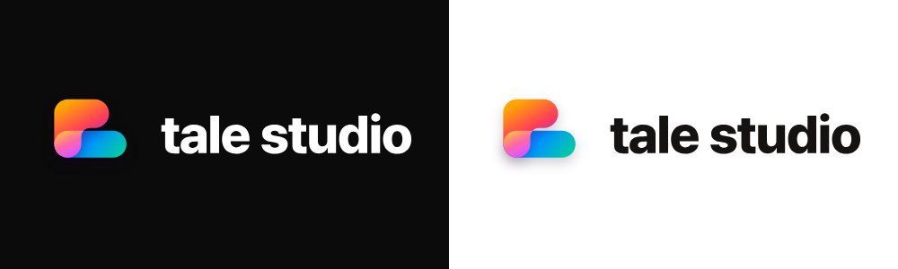

# Tale Studio 로고 (확정 · 2026-11-02)

## 파일

| 파일 | 쓰는 곳 |
|---|---|
| `tale-symbol.svg` | 심볼 · 어두운 바탕(기본) — 사이드바 홈, 앱 아이콘, 파비콘 |
| `tale-symbol-light.svg` | 심볼 · 흰 / 밝은 바탕 |
| `tale-lockup.svg` | 심볼 + "tale studio" · 어두운 바탕 (흰 글자) |
| `tale-lockup-light.svg` | 심볼 + "tale studio" · 밝은 바탕 (#141312 글자) |

Figma: Components 페이지 Logo 섹션의 `Logo/Tale Symbol`, `Logo/Tale Lockup` (Theme=Dark · Light)

## 로고가 나오기까지

1. **첫 글자 T** — 테일(Tale)의 T에서 시작. 이야기의 첫 장
2. **리본처럼 접기** — T의 윗줄을 리본으로 바꾸고 U자로 접어 두 겹. 장면이 이어진다는 뜻
3. **책 두 권** — 두 겹을 책 두 권처럼 눕혀 포갬. 이야기가 한 권씩 쌓여 작품이 됨
4. **단계 3 + 3** — 위 책에 앞 세 단계(기획 · 글 · 그림), 아래 책에 뒤 세 단계(콘티 · 연출 · 편집)
5. **사이의 Lumi** — 두 책이 겹치는 자리에서 두 색이 빛처럼 섞임. 앞뒤 단계를 잇는 AI 동료 Lumi

## 색과 이유

| 부분 | 색 | 이유 |
|---|---|---|
| 위 책 | 오렌지 골드 `#FFA600` → 로즈 레드 `#FF3D5A` → 바이올렛 `#7B2FFF` | Producer · Writer · Artist. 이야기를 만드는 앞 단계라 따뜻한 색(아이디어 · 감정) |
| 아래 책 | 딥 블루 `#2F45FF` → 애저 `#0096FF` → 민트 틸 `#00C9A7` | Storyboard · Director · Editor. 영상으로 옮기는 뒤 단계라 시원한 색(기술 · 완성) |
| 겹치는 곳 | 따로 칠하지 않음 — 위 책 색을 스크린(빛 더하기) 90%로 겹침 | 따뜻한 위 책과 시원한 아래 책이 빛처럼 섞여 핑크 · 마젠타로 빛남. 앞뒤 단계를 잇는 Lumi. 검정 · 흰 바탕에서 똑같이 보임 |
| 밝은 바탕 | 같은 로고, 그림자만 30% → 18% | `-light` 파일 |

- **딥 디지털**: 파스텔 · 흐린 색은 "AI 툴" 느낌이 약했어요. 채도는 끝까지 올리고 밝기는 낮춰서 검정 위에서 디지털 화면처럼 빛나게 했어요.
- **사선 흐름**: 두 책 모두 왼쪽 위 → 오른쪽 아래로 흘러요. 움직임이 느껴지고, 두 책이 하나로 읽혀요.
- **둥근 모서리 · 그림자만**: 모든 모서리를 완전히 둥글게 해서 말랑한 Lumi, 앱의 둥근 칩 · 카드와 같은 형태 언어로 맞췄어요. 효과는 아래 그림자 하나만 써요. 흰 광택 · 테두리는 넣지 않아요.
- 로고의 여섯 색 = 앱 안 단계 색(Producer → Editor)

## 쓰는 법

- 어두운 바탕이 기본. 흰 · 밝은 바탕에서는 Light 버전
- 글자는 "tale studio" 소문자, Pretendard ExtraBold
- 색 · 기울기 · 겹침 색은 바꾸지 않아요
